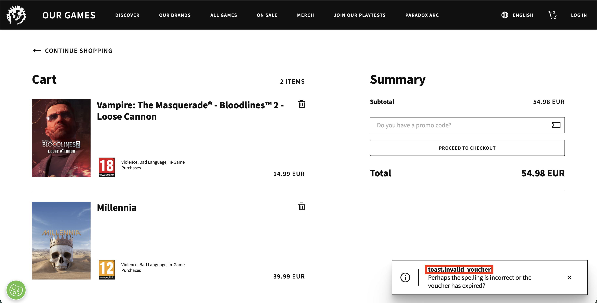
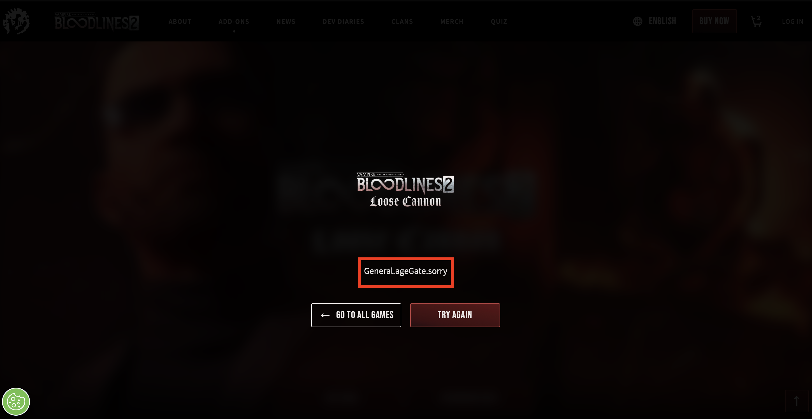
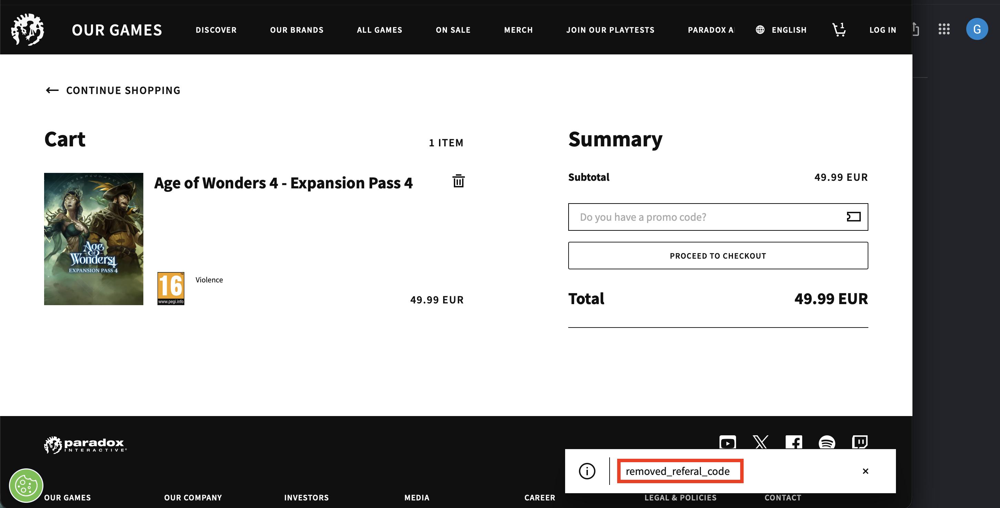

# Bugs and UX issues found

**Environment:** https://www.paradoxinteractive.com/our-games (live production), guest user, English and Chinese (beta) store languages, Chromium-based browser on macOS, locale en-US
**Date:** 11–12 October 2026 (BUG-09 and BUG-10 were found while building the automation)
**Viewports:** desktop 1366x850, narrow ~580 px

| ID | Title | Type | Severity |
|---|---|---|---|
| BUG-01 | Age gate allows adding to cart after an under-age date of birth | Compliance | High |
| BUG-02 | Invalid promo code error shows a raw localization key | Bug / Localization | Medium |
| BUG-03 | Age gate refusal shows a raw localization key | Bug / Localization | Medium |
| BUG-04 | Tile "Add to cart" can't be reached with the keyboard | Accessibility | Medium |
| BUG-05 | No tile "Add to cart" on narrow or mobile screens | UX | Low |
| BUG-06 | All tile "Add to cart" buttons share the same accessible name | Accessibility | Low |
| BUG-07 | No warning when cart items overlap (season pass plus included add-on) | UX | Low |
| BUG-08 | Minor polish issues | Polish | Trivial |
| BUG-09 | Suspected: cart can silently lose an item after opening another page | Bug / Data loss | High if confirmed |
| BUG-10 | Removing a creator referral code shows a raw localization key | Bug / Localization | Low |

---

## BUG-01: Age gate allows adding to cart after an under-age date of birth
**Severity:** High. Age ratings are a legal and platform compliance requirement. A visitor who has just declared they're too young can still put an age-restricted game in the cart.

**Steps to reproduce**
1. In a fresh browser session, open the info page of an age-restricted game.
2. In the age gate, enter a date of birth below the minimum age and confirm.
3. Access to the product page is refused (see BUG-03).
4. Go to the All games or On Sale listing and hover over the same game's card.
5. Click its **Add to cart** button.

**Expected:** after an under-age declaration, the store doesn't let that session add the age-restricted game, or the quick add triggers the same age check.

**Actual:** the game is added to the cart and the header counter increases. The tile's quick add doesn't check the age gate at all.

**Notes:**
- Checkout is out of scope on the live site, so it's unknown whether checkout blocks the purchase later. Even if it does, the player gets inconsistent messages.
- Simply clearing the session and entering a different date also gets past the gate. That's normal for self-declared age gates, but it's why the cart and checkout should respect the declaration that was made.

---

## BUG-02: Invalid promo code error shows a raw localization key
**Severity:** Medium. The only feedback a player gets is partly untranslated developer text, so it's unclear why the code was rejected. The same key shows in Chinese (beta), the store's only other language, so every store language is affected.

**Steps to reproduce**
1. Add any item to the cart and open `/our-games/cart`.
2. Type `NOTAREALCODE123` into "Do you have a promo code?".
3. Press Enter.

**Expected:** a readable error such as "Invalid promo code", plus helpful body text. The entered code stays in the field so it can be corrected.

**Actual:** a small toast appears in the bottom-right corner:
- Title: `toast.invalid_voucher` (a raw string key instead of translated text)
- Body: "Perhaps the spelling is incorrect or the voucher has expired?"

The same raw key appears as the toast title with the store set to **Chinese (beta)**.

The field is also cleared, so the player has to retype the whole code to fix a typo.


*The toast with the raw key `toast.invalid_voucher` (outlined in red). The promo code field has already been cleared.*

**Evidence:** the server rejects the code as expected. `PATCH https://paradox.commercelayer.io/api/orders/<id>` with `coupon_code` returns **422** with `"detail": "coupon_code - doesn't exist"`. The problem is in how the front end displays the error.

**Notes:**
- **Terminology:** the toast says "voucher" while the field says "promo code". The UI should use one term.
- **Placement:** the toast is small and far from the field, and disappears after a few seconds, so it's easy to miss.
- **No Apply button:** pressing Enter is the only way to submit a code, and nothing on the page says so.
- **To check:** whether the toast is announced to screen readers.
- **Cause (from the store's own translation data):** the English title exists, as `Cart.toast.invalid_voucher` = "Invalid voucher". The page asks for it under a different path, gets nothing, and shows the key instead. So the fix is in the lookup, not in the translation files.
- **Hardcoded label:** the field's "Promo Code" label is written directly in the page's script instead of coming from the translation files, so it stays in English in every store language.
- The success toasts use the same "voucher" wording: "Added voucher to cart", "Removed voucher from cart".

---

## BUG-03: Age gate refusal shows a raw localization key
**Severity:** Medium. The only message an under-age visitor sees is untranslated developer text, on a page that has a compliance purpose.

**Steps to reproduce**
1. In a fresh browser session, open the info page of an age-restricted game.
2. In the age gate, enter a date of birth below the minimum age and confirm.

**Expected:** a clear, translated message explaining that the visitor doesn't meet the age requirement.

**Actual:** the message shows the raw string key `General.ageGate.sorry`.


*The age gate refusal on an age-restricted product page (Bloodlines 2 – Loose Cannon), showing the raw key `General.ageGate.sorry` (outlined in red).*

**Notes:** this is the second raw key found (see BUG-02, `toast.invalid_voucher`). Two missing strings in a short session suggest a wider gap in the localization pipeline, rather than one-off mistakes. A cheap automated check for this is listed under "What I'd test next" in TEST_CASES.md.

**Cause (from the store's own translation data):** the age gate's English translations contain `day`, `enter_birth_date` and `we_need_your_age`, but no `sorry`, so the refusal message has nothing to display except its key.

---

## BUG-04: Tile "Add to cart" can't be reached with the keyboard
**Severity:** Medium. Keyboard and assistive-technology users can't use quick add from the listings (WCAG 2.1.1 Keyboard). They can still add from the buy page.

**Steps to reproduce**
1. Open `/our-games/all-games` or `/our-games/on-sale` on a desktop browser.
2. Move the mouse pointer off the product tiles (for example onto the header) and leave it there.
3. Using only the **Tab** key, move through the product tiles. In Safari, use **Option+Tab**, or turn on Settings → Advanced → "Press Tab to highlight each item on a webpage"; by default Safari's Tab skips links.

**Expected:** focus reaches each single-price tile's "Add to cart" button, and Enter adds the item.

**Actual:** focus moves from tile to tile (each tile is a link), but never reaches an "Add to cart" button. The button only appears while the mouse is over the tile; otherwise its container is `display: none`, so it can't receive focus. Same result on All games (20 of 20 tiles) and On sale (16 of 16).

**Notes:** if the mouse pointer happens to rest over a tile, that tile's button is shown and Tab can reach it, but only for that one tile. That's why the button sometimes seems reachable; a keyboard user can't rely on it. A common fix is to also show the button when the tile has keyboard focus (CSS `:focus-within`).

---

## BUG-05: No tile "Add to cart" on narrow or mobile screens
**Severity:** Low. Mobile shoppers need extra taps (card, then Buy now, then Add to cart). Possibly a design choice; worth confirming with the team.

**Steps to reproduce**
1. Open `/our-games/on-sale` in a window about 580 px wide, or on a phone.
2. Tap or hover over a single-price product card.

**Expected:** a way to add the item from the card, as on desktop.

**Actual:** the "Add to cart" button is hidden (`display: none`) and doesn't appear on hover or tap.

---

## BUG-06: All tile "Add to cart" buttons share the same accessible name
**Severity:** Low. A screen-reader user hears a list of identical "Add to cart" buttons and can't tell which product each belongs to (WCAG 2.4.6 / 2.5.3).

**Steps to reproduce**
1. Open `/our-games/all-games` and inspect the accessibility tree (or use a screen reader's buttons list).

**Expected:** each button includes the product, for example "Add BATTLETECH - Heavy Metal to cart". The cart page already does this well: "Remove BATTLETECH - Heavy Metal from cart".

**Actual:** every button is named "Add to cart".

---

## BUG-07: No warning when cart items overlap
**Severity:** Low. Rare, but the player pays twice for the same content and then needs a refund.

**Steps to reproduce**
1. Open `/games/battletech/buy?tab=add-ons` and add **BATTLETECH - Heavy Metal** to the cart.
2. On the same page, add **BATTLETECH Season Pass**. Its product page says Heavy Metal is included in the Season Pass.
3. Open the cart.

**Expected:** a warning that Heavy Metal is already included in the Season Pass, or the store prevents the overlap.

**Actual:** both items are in the cart with no warning. Subtotal 58.74 GBP, total 46.18 GBP.

**Notes:** players have reported a similar problem with Paradox bundles on Steam (Paradox forum, May 2024: "Steam Ultimate Bundle shows content I already own").

---

## BUG-08: Minor polish issues
**Severity:** Trivial.

- **Cart page title:** the browser tab shows only "Paradox Interactive". Every other page uses "`<Page> - Paradox Interactive`" (for example "All games - Paradox Interactive"). Unhelpful for tabs, history and screen readers.
- **Inconsistent filter label:** the "Expansion" quick filter's label is "expansion" in lowercase in the page markup, unlike "DLC" and "Full Game". It looks fine on screen (CSS shows it in capitals), but screen readers and analytics get the lowercase text.
- **Trailing space in product data:** the base game's product card data has the title "Europa Universalis IV " with a trailing space (seen in the card's analytics attributes). Not visible on screen, but it can break exact-match lookups and reports.

---

## BUG-09: Suspected: cart can silently lose an item after opening another page
**Status:** suspected, intermittent. Found by the automated CART-01 test. Reproduced only by automation: once in a normal run of the test suite, and 2 times in 9 diagnostic runs that clicked straight after the page opened. Not reproduced manually in Safari or Chromium; human clicks are probably too slow to hit the timing window.
**Severity:** High if confirmed. A shopper who opens another page and adds a second item can lose the first one without any message. Direct revenue risk.
**Environment:** Playwright's Chromium, desktop 1366x850.

**Steps to reproduce**
1. In a fresh browser session, open the browser's developer tools on the Network tab and filter on `commercelayer`.
2. Open `/our-games/on-sale`, hover over a product card and click **Add to cart**. The header shows 1.
3. Open `/our-games/all-games`.
4. As soon as the product tiles appear, hover over another product's card and click **Add to cart**.
5. Open the cart.

**Expected:** both items are in the cart and the header shows 2.

**Actual (intermittent):** while All games is loading, the store sends a `DELETE /api/line_items/<id>` for the existing item, although nobody removed it. The header drops to "View cart" (empty). The next Add to cart creates a **new order** (`POST /api/orders`, new `orderId` in localStorage) containing only the second item. The first item is gone, with no message.

**Evidence:** Playwright trace of a failing run: [`evidence/BUG-09-trace.zip`](evidence/BUG-09-trace.zip). It holds screenshots, the actions taken and every network call. Open it with `playwright show-trace evidence/BUG-09-trace.zip` (or drag it onto trace.playwright.dev), then look at the Network tab. Contains no personal data; the guest cart tokens in it have expired. Key network calls (times in seconds):
```
36.18 POST   /api/orders                       first add creates the order
36.61 POST   /api/line_items                   first item added, header shows 1
37.60 GET    /api/orders/JZYhoWjWOe            cart loaded
38.08 GET    /api/orders/JZYhoWjWOe            All games starts loading
38.19 DELETE /api/line_items/bmetDBqAZn  204   first item deleted, not requested by the user
38.99 POST   /api/orders                       a new order is created
39.31 POST   /api/line_items                   second item goes into the new order
39.50 DELETE /api/line_items/bmetDBqAZn  404   the same line deleted again, already gone
```

**Notes:**
- The repeated DELETE of a line that's already gone (404) suggests the store's own clean-up code runs twice, which points to a race between loading the existing cart and the new page starting up. The page also fetches the order several times on load in failing runs.
- Not seen when the page is left idle after opening it (0 of 3 runs), so the trigger seems to be interacting with the page while it's still loading the cart.
- Worth retesting with network throttling, which should widen the timing window.
- The CART-01 automated test fails with a message naming BUG-09 when this happens. It deliberately has no retry or workaround.

---

## BUG-10: Removing a creator referral code shows a raw localization key
**Severity:** Low. Only shoppers who arrive through a content creator's referral link see the referral banner, but it's paid partner traffic, and it's the third raw key on the store (see BUG-02 and BUG-03).

**How it was found:** by comparing the translation keys the cart's script uses with the translation data the store sends to the browser, then confirmed on screen.

**Steps to reproduce**
1. In a private browser window, add any item to the cart and open `/our-games/cart`.
2. Simulate arriving through a creator's referral link. Those links set a cookie named `irclickid` (impact.com affiliate tracking). In the browser console run `document.cookie = "irclickid=qa-test; path=/"`, then reload the cart.
3. A **"Creator Referral Activated"** banner appears in the summary. Remove it.

**Expected:** a translated confirmation, such as "Removed referral code".

**Actual:** the toast shows the raw key `removed_referal_code`.


*The toast after removing the referral banner, showing the raw key `removed_referal_code` (outlined in red).*

**Cause (from the cart's script and translation data):** the script asks for `removed_referal_code` (one "r"), while the translation file has `Cart.toast.removed_refferal_code` (double "f") with the text "Removed referral code". Neither matches the other, nor the correct spelling "referral".

**Notes:**
- The banner itself shows only "Creator Referral Activated", which is written directly in the script, so it's never translated.
- The banner's remove control asks for a label key, `remove_referral_code`, that doesn't exist in the translation data at all. No text is visible for it, so it's probably used as the button's hidden label. **To check:** what a screen reader announces for that button.
- Three spellings of "referral" across the code and translations (referral, referal, refferal) suggest keys typed by hand. A build-time check that every key used in the code exists in the translation files would catch this whole class of bug (see also "What I'd test next" in TEST_CASES.md).
- Triggering the banner by hand sends a made-up affiliate click ID to the store. Without a purchase nothing is credited, but it's worth agreeing with the team before doing this on production.
